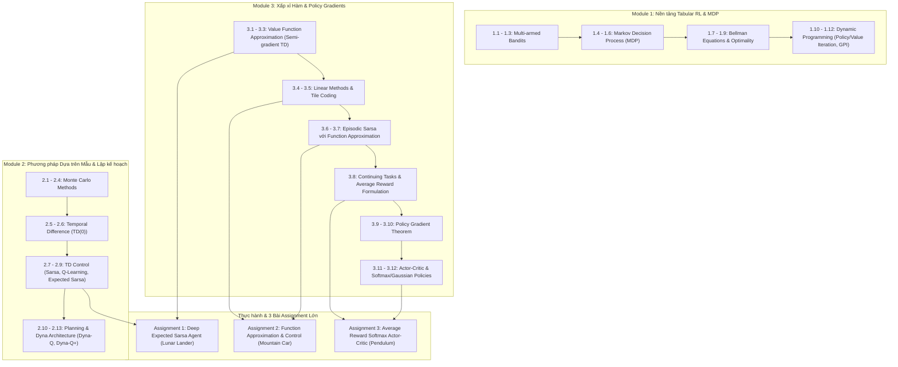

# BỘ KNOWLEDGE BASE MÔN REL (REINFORCEMENT LEARNING) - FPT UNIVERSITY

> **Mục tiêu**: Hệ thống hóa toàn bộ kiến thức lý thuyết từ 38 bài giảng (slide `0. Course Introduction` đến `3.12` và `6. Review course`) kết hợp cẩm nang thực chiến chuyên sâu phục vụ hoàn thành xuất sắc 3 bài Assignment lớn của môn học.

---

## 🗺️ Bản đồ Cấu trúc Tri thức (Knowledge Map)

---

## 📚 Danh mục Tài liệu trong Bộ Knowledge Base

| Tập tin | Tên tài liệu | Slide bài giảng đối ứng | Phục vụ trực tiếp |
| :--- | :--- | :--- | :--- |
| [`01_fundamentals_and_mdp.md`](./01_fundamentals_and_mdp.md) | **Cơ sở Lý thuyết RL, MDP & Quy hoạch Động (DP)** | Slide 1.1 – 1.12 | Hiểu nền tảng toán học, Bellman expectation/optimality, Policy Iteration, GPI. |
| [`02_sample_based_learning_and_planning.md`](./02_sample_based_learning_and_planning.md) | **Phương pháp Dựa trên Mẫu (MC, TD) & Planning** | Slide 2.1 – 2.13 | Nắm vững Sarsa, Q-Learning, Expected Sarsa, mô hình Dyna-Q/Dyna-Q+. |
| [`03_function_approximation_and_tile_coding.md`](./03_function_approximation_and_tile_coding.md) | **Xấp xỉ Hàm Tuyến tính & Kỹ thuật Tile Coding** | Slide 3.1 – 3.7 | **Assignment 2** (Mountain Car với Tile Coding & Linear Sarsa). |
| [`04_policy_gradients_and_actor_critic.md`](./04_policy_gradients_and_actor_critic.md) | **Continuing Tasks, Policy Gradients & Actor-Critic** | Slide 3.8 – 3.12 | **Assignment 3** (Pendulum với Average Reward Softmax Actor-Critic). |
| [`05_deep_rl_and_neural_fitted_agents.md`](./05_deep_rl_and_neural_fitted_agents.md) | **Kiến trúc Deep RL, Replay Buffer & Bộ tối ưu Adam** | Slide 3.1 + Deep RL | **Assignment 1** (Deep Expected Sarsa giải quyết Lunar Lander). |
| [`06_assignment_handbook.md`](./06_assignment_handbook.md) | **Cẩm nang Thực chiến & Giải mã 3 Bài Assignment** | Assignment-student | Hướng dẫn chi tiết từng dòng code, input/output shape, unit tests, pitfalls. |
| [`07_formula_and_algorithm_cheatsheet.md`](./07_formula_and_algorithm_cheatsheet.md) | **Bí kíp Tra cứu Nhanh Công thức & Pseudo-code** | Toàn bộ khóa học | Bảng tổng hợp công thức toán, đạo hàm, quy tắc update để ôn thi và debug. |

---

## 🎯 Tóm tắt 3 Bài Assignment & Công nghệ Trọng tâm

### 1. Assignment 1: Deep Expected Sarsa Agent (Lunar Lander)
- **Bài toán**: Điều khiển tàu vũ trụ hạ cánh an toàn xuống bãi đáp mặt trăng (môi trường `LunarLander-v2`, 8 chiều trạng thái liên tục, 4 hành động rời rạc).
- **Kiến trúc & Thuật toán**:
  - Mạng nơ-ron xấp xỉ giá trị hành động (`ActionValueNetwork` - MLP nhiều tầng ẩn).
  - Thuật toán tối ưu **Adam** (tính momentum $m_t$, second moment $v_t$, bias correction).
  - Bộ nhớ đệm kinh nghiệm **Experience Replay Buffer** (lấy mẫu ngẫu nhiên đồng đều ngắt tương quan chuỗi thời gian).
  - Chính sách xác suất **Softmax Policy** với tham số nhiệt độ $\tau$ và kỹ thuật trừ max chống tràn số (`Log-Sum-Exp`).
  - Mạng mục tiêu cố định `current_q` để tính TD error mục tiêu ổn định cho Expected Sarsa.

### 2. Assignment 2: Function Approximation and Control (Mountain Car)
- **Bài toán**: Lái xe leo dốc thoát khỏi thung lũng trọng lực (vị trí $[-1.2, 0.5]$, vận tốc $[-0.07, 0.07]$, động cơ yếu phải lắc qua lại để tích lũy thế năng).
- **Kiến trúc & Thuật toán**:
  - Trích xuất đặc trưng liên tục thành chỉ số rời rạc bằng **Tile Coding** (`MountainCarTileCoder` kết hợp thư viện `tile_coding.IHT`).
  - Thuật toán **Linear Episodic Semi-gradient Sarsa**: tính $Q(s, a) = \sum_{i \in \text{tiles}} w_i$ cực nhanh nhờ biểu diễn thưa (sparse active features).
  - Chính sách khám phá $\epsilon$-greedy.
  - Phân tích độ nhạy của tham số: so sánh hiệu năng giữa các thiết lập tilings ($4, 8, 16$) và hệ số học $\alpha$.

### 3. Assignment 3: Continuing Average Reward Softmax Actor-Critic (Pendulum Swing-Up)
- **Bài toán**: Cân bằng con lắc ngược từ vị trí tự do rủ xuống (task liên tục không hồi kết, góc $[-\pi, \pi]$, vận tốc góc $[-2\pi, 2\pi]$, 3 mức mô-men xoắn $[-1, 0, 1]$).
- **Kiến trúc & Thuật toán**:
  - Mô hình hóa dưới dạng **Continuing Task** sử dụng công thức **Average Reward** ($r(\pi)$) thay vì Discount Factor truyền thống ($\gamma = 1$).
  - **Tile Coding** rời rạc hóa góc và vận tốc góc với 32 tilings.
  - **Actor**: Học sở thích hành động $h(s, a, \theta) = \sum_{i} \theta[a, i]$ tạo chính sách Softmax $\pi(a|s)$.
  - **Critic**: Học giá trị vi phân (differential state-value) $v(s, w) = \sum_{i} w[i]$.
  - Cập nhật đồng bộ 3 thành phần qua Differential TD Error: $\delta = R - \bar{R} + v(S') - v(S)$:
    1. Ước lượng phần thưởng trung bình: $\bar{R} \leftarrow \bar{R} + \alpha_r \delta$.
    2. Trọng số Critic: $w \leftarrow w + \alpha_w \delta x(S)$.
    3. Trọng số Actor: $\theta \leftarrow \theta + \alpha_\theta \delta \nabla_\theta \ln \pi(A|S)$.

---

## 💡 Hướng dẫn Học tập & Sử dụng Bộ Tài liệu

1. **Nếu bạn muốn hiểu bản chất toán học từ slide**: Đọc tuần tự từ `01` $\to$ `02` $\to$ `03` $\to$ `04`.
2. **Nếu bạn chuẩn bị làm Assignment**:
   - Trước khi làm Assignment 1 $\to$ Đọc `05_deep_rl_and_neural_fitted_agents.md` và phần tương ứng trong `06_assignment_handbook.md`.
   - Trước khi làm Assignment 2 $\to$ Đọc `03_function_approximation_and_tile_coding.md` và phần tương ứng trong `06_assignment_handbook.md`.
   - Trước khi làm Assignment 3 $\to$ Đọc `04_policy_gradients_and_actor_critic.md` và phần tương ứng trong `06_assignment_handbook.md`.
3. **Khi cần tra cứu công thức nhanh, debug hoặc ôn tập thi**: Mở `07_formula_and_algorithm_cheatsheet.md`.
